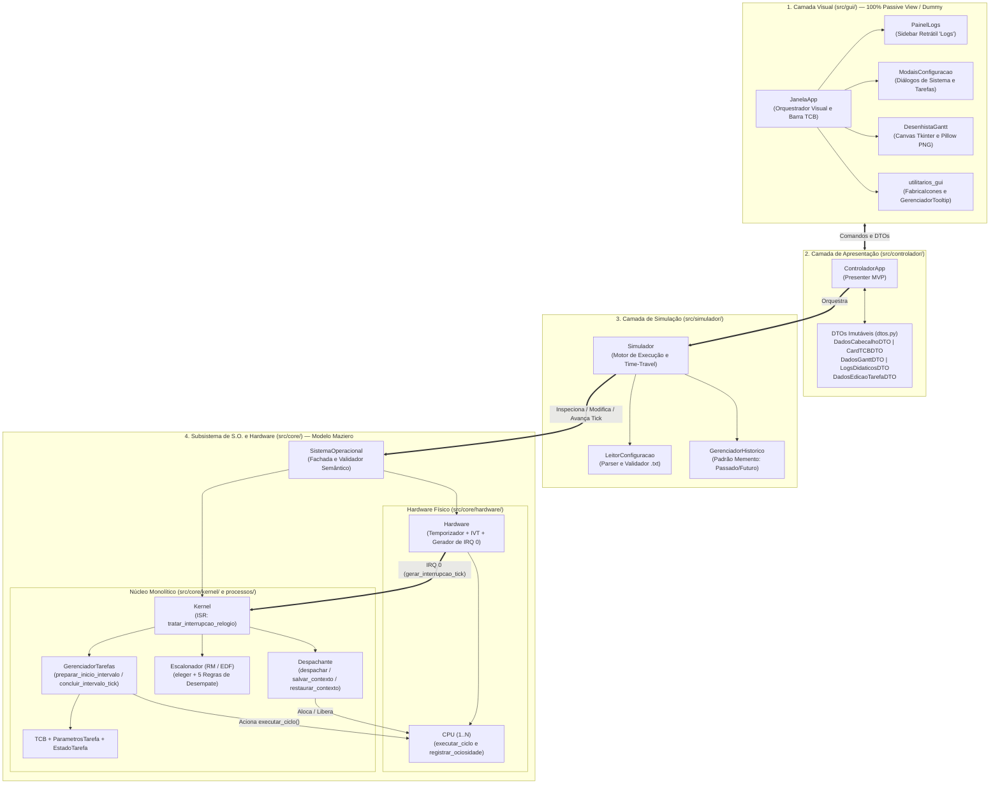

# Documentação Técnica e Arquitetural: Simulador de Sistema Operacional Multitarefa (Versão 0.6)

**Autor Original da Especificação:** Prof. Dr. Marco Aurélio Wehrmeister  
**Referência Teórica Fundamental:** Prof. Dr. Carlos Alberto Maziero (*Sistemas Operacionais: Conceitos e Mecanismos*)  
**Arquitetura Implementada:** Orientada a Objetos Coesa em Camadas, com Núcleo Monolítico Simulado, Interrupção de Hardware (IRQ 0), Padrão *Passive View* (GUI *Dummy*), DTOs Tipados (`@dataclass`) e Python 3.12+

---

## 1. Visão Geral e Objetivos do Projeto

O projeto consiste em um software de simulação visual e interativa de um **Sistema Operacional Multitarefa Preemptivo de Tempo Compartilhado**, projetado para permitir o estudo prático e a inspeção passo a passo dos mecanismos internos de gerência de tarefas e políticas de escalonamento de tempo real.

De acordo com a especificação oficial (`requisitos_funcionais.pdf`), os objetivos pedagógicos e técnicos são:
1. **Gerenciamento e Escalonamento de Tarefas:** Aprofundar o estudo sobre a implementação de escalonadores preemptivos, a execução concorrente de múltiplas tarefas em múltiplos processadores e a representação gráfica temporal dessa execução (Gráfico de Gantt).
2. **Interação e Sincronização entre Tarefas:** Aprimorar o conhecimento sobre serviços de exclusão mútua e sincronização encontrados em sistemas operacionais multitarefa (escopo expandido no Projeto B).
3. **Problemas Clássicos de Escalonamento:** Compreender e tratar anomalias de escalonamento e concorrência, tais como inanição (*starvation*), inversão de prioridades e impasse (*deadlock*).

---

## 2. Requisitos Funcionais (Extraídos de `requisitos_funcionais.pdf`)

### 2.1. Requisitos Gerais (Comuns aos Projetos A e B)

1. **Simulação Multitarefa Preemptiva:** Implementar um software que simule a execução de tarefas em um sistema operacional multitarefa preemptivo de tempo compartilhado.
2. **Multiprocessamento Simétrico ($1$ a $N$ CPUs):** O computador simulado possui múltiplos processadores capazes de executar tarefas simultaneamente. A quantidade de processadores é configurada pelo usuário no intervalo $[1, N]$.
3. **Visualização Gráfica Completa e Legenda:** Permitir a visualização gráfica da execução das tarefas ao longo do tempo para cada processador. Todos os eventos relevantes ao longo da execução devem aparecer claramente com elementos gráficos distintos para cada tipo de evento, acompanhados de uma **legenda** explicativa e da indicação clara de **em qual processador** cada tarefa está executando.
4. **Controle Interativo e Modificação em Tempo de Execução:** O software deve ser configurável e permitir controlar a simulação (avançar e retroceder no tempo), possibilitando que o estado atual ou as características de qualquer tarefa sejam modificados manualmente em qualquer passo/estágio da simulação.
5. **Execução Autônoma (*Standalone*):** A linguagem de programação é de livre escolha, mas o software gerado deve poder ser executado diretamente sem a necessidade de instalar bibliotecas extras, interpretadores ou *runtimes* na máquina do usuário final (distribuído como executável `.exe` independente).
6. **Documentação no Código-Fonte:** Todo o código-fonte deve ser comentado de modo que qualquer desenvolvedor ou avaliador compreenda o papel de cada classe, método e componente, bem como as justificativas das decisões de implementação.

---

### 2.2. Requisitos do Projeto A — Implementação Inicial do Simulador

#### 2.2.1. Relógio Global, Processadores e TCB (Requisitos 1.1 a 1.4)
* **Relógio Global por *Ticks* (Req. 1.1):** O sistema simulado inclui um relógio global cuja passagem do tempo ocorre na forma discreta de *ticks* de relógio. A cada *tick*, o hardware gera uma interrupção de tempo e a simulação verifica a necessidade de realizar ações ou tratar eventos relevantes. O tempo de simulação é lógico e independente do tempo físico do mundo real.
* **Fila de Prontos Global e Desligamento de CPUs Ociosas (Req. 1.2):** O escalonador minimiza a ociosidade dos processadores: **não existem tarefas na fila de prontos enquanto houver CPUs livres**. A fila de prontos é única e global no sistema. Quando não é possível atribuir uma tarefa pronta a uma CPU, esse processador é **desligado**, e o período de tempo em que permaneceu desligado é apresentado ao usuário no cabeçalho e na faixa dedicada (`CPU OFF`) do Gráfico de Gantt.
* **Estrutura Única de Controle — TCB (Req. 1.3):** Todas as informações de cada tarefa (antes, durante e depois da simulação) são armazenadas em uma única estrutura de dados: a `@dataclass` `TCB` (*Task Control Block*), definida em `src/core/kernel/tcb.py`.
* **Fidelidade Temporal (Req. 1.4):** A execução de cada tarefa respeita rigorosamente seus parâmetros temporais configurados (instante de ingresso, duração de computação, período de reativação, prazo/*deadline* e ocorrência de eventos).

#### 2.2.2. Modos de Execução e *Time-Travel* (Requisito 1.5)
O simulador oferece dois modos de operação:
1. **Execução Passo-a-Passo — Modo *Debugger* (Req. 1.5.1 e 1.5.2):**
   * Permite examinar o estado atual e as métricas correntes do sistema operacional e de cada tarefa individualmente na **barra horizontal de TCBs abaixo do Gráfico de Gantt**, além de acompanhar na sidebar direita **"Logs"** as funções internas executadas pelo núcleo.
   * Permite ao usuário **avançar e retroceder** a simulação livremente (*Time-Travel*). O histórico do estado do sistema a cada passo é preservado em memória (`GerenciadorHistorico`), refletindo diretamente no relógio global.
   * Permite modificar manualmente o estado atual (`NOVA`, `PRONTA`, `EXECUTANDO`, `SUSPENSA`, `AGUARDANDO`, `FINALIZADA`) ou as características de qualquer tarefa em qualquer passo da simulação através do botão de edição no cartão do TCB.
2. **Execução Completa sem Intervenção Humana (Req. 1.5.3):**
   * Executa a simulação integralmente de forma direta e apresenta o resultado final após o término das 10 execuções de todas as tarefas periódicas.

#### 2.2.3. Visualização Gráfica — Gráfico de Gantt (Requisitos 2.1 a 2.5)
* **Representação de Estados e Cores (Req. 2.1):**
  * **Executando:** Preenchimento sólido com a cor específica da tarefa (definida em hexadecimal) e indicação do processador utilizado (`C1`, `C2`, ...).
  * **Pronta (em fila de espera):** Ausência de cor (bloco branco/vazado).
  * **Suspensa:** Cor preta com preenchimento pontilhado/hachurado (`SUSP`), diferenciando-se claramente da execução normal.
* **Marcadores Exatos de Eventos (Req. 2.2 e 4.3):**
  * **Ingresso/Ativação:** Seta verde vertical ($\downarrow$) no *tick* exato de chegada ou reativação periódica.
  * **Término de Execução:** Seta azul vertical ($\uparrow$) no *tick* exato em que a tarefa completa sua duração.
  * **Perda de Prazo (*Deadline*):** Triângulo de alerta vermelho (`!`) no *tick* do estouro do prazo e borda vermelha destacada.
  * **Desempate por Sorteio:** Losango dourado/laranja ($\diamond$) no instante em que a tarefa sorteada (re)começa a executar.
* **Sincronia com o Modo de Execução (Req. 2.3):** No modo passo-a-passo, o Gráfico de Gantt é atualizado na tela a cada *tick* ou edição manual.
* **Exportação Obrigatória para Arquivo de Imagem (Req. 2.4):** Exporta um arquivo de imagem (`.png` / `.jpg`) em alta resolução contendo toda a simulação (tarefas, CPUs desligadas, eventos e legenda), sem ser captura de tela (*print screen*) da janela e sem limite de tempo máximo.
* **Padrão Visual Maziero e Ordenação do Eixo Y (Req. 2.5):** Inspirado nas figuras da **Seção 6.4 do livro do Prof. Carlos Maziero**, com as tarefas dispostas no eixo Y em **ordem decrescente em relação ao ID** (a tarefa de menor ID fica mais próxima da base/eixo X).

#### 2.2.4. Parametrização e Arquivo de Configuração (Requisitos 3.1 a 3.4)
* **Configuração Prévia e Dinâmica com Validação Semântica (Req. 3.1 e 3.4):** Permite configurar parâmetros do sistema e das tarefas antes e durante a simulação. Caso uma modificação solicitada durante a execução seja semanticamente inválida (ex.: colocar uma tarefa em execução antes de seu instante de ingresso, ou informar duração/período inválidos), o sistema rejeita a modificação e exibe mensagem clara explicando o motivo.
* **Valores Padrão Sugeridos (Req. 3.2):** Ao iniciar, o software sugere valores padrão (`Algoritmo = RM`, `Quantum = 0`, `CPUs = 1` e 1 tarefa inicial editável), que podem ser sobrescritos pelo carregamento de arquivo `.txt` ou pelos modais de configuração.
* **Especificação do Arquivo de Entrada `.txt` (Req. 3.3):**
  ```text
  algoritmo_escalonamento;quantum;qtde_cpus
  id;cor;ingresso;duracao;periodo;prazo;lista_eventos
  ```
  * Tratamento *case-insensitive*, `;` opcional no final da linha, espaços e linhas em branco ignorados, carregamento livre de qualquer diretório/disco/pendrive (`LeitorConfiguracao`).

#### 2.2.5. Algoritmos de Escalonamento e Critérios de Desempate (Requisitos 4.1 a 4.4)
* **Políticas Obrigatórias (Req. 4.1):** **RM (*Rate Monotonic*)** e **EDF (*Earliest Deadline First*)** preemptivos.
* **Extensibilidade (Req. 4.2):** Fábrica `criar_escalonador` e contrato base em `src/core/kernel/escalonador.py`.
* **Ordem Estrita de Desempate (Req. 4.3):**
  1. Tarefa executando imediatamente antes (evita troca de contexto para a própria tarefa).
  2. Menor prazo absoluto (*deadline*).
  3. Menor instante de ingresso original.
  4. Menor duração de computação.
  5. Sorteio determinístico (com marcação visual no Gráfico de Gantt quando decisivo).
* **Tarefas Periódicas e Limite de 10 Execuções (Req. 4.4):** Tarefas periódicas encerram após **10 execuções completas**. Tarefas aperiódicas (`periodo == 0`) são ignoradas no Projeto A com emissão de alerta explícito ao usuário.

---

## 3. Requisitos Técnicos e Arquitetura Implementada

A arquitetura organiza o sistema em **4 camadas coesas e desacopladas** (`gui`, `controlador`, `simulador` e `core`), com baixa complexidade ciclomática e comunicação baseada em objetos de valor imutáveis (`@dataclass(frozen=True)`):



---

### 3.1. Fundamentação Teórica no Livro *Sistemas Operacionais: Conceitos e Mecanismos* (Carlos Maziero)

| Conceito no Livro (Maziero) | Referência no Livro | Módulo Implementado (`src/core/`) | Papel Arquitetural no Simulador |
| :--- | :--- | :--- | :--- |
| **Estrutura Geral do Sistema Computacional** | Cap. 2, Seção 2.1, Fig. 2.1 | `SistemaOperacional` (`src/core/sistema_operacional.py`) | Fachada que integra o Hardware físico e o Núcleo Monolítico (`Kernel`), expondo operações seguras de inspeção e edição validada via `ParametrosTarefa`. |
| **Temporizador (Timer), IVT e Interrupção de Hardware (IRQ)** | Cap. 2, Seções 2.2.2 e 2.2.4; Cap. 4, Fig. 4.6 | `Hardware` (`src/core/hardware/hardware.py`) e `CPU` (`src/core/hardware/cpu.py`) | O `Hardware` registra o tratador do `Kernel` na Tabela de Interrupções (`registrar_tratador_interrupcao`), pulsa o relógio (`gerar_interrupcao_tick`) interrompendo o `Kernel` e executa os ciclos de instrução em cada `CPU` (`executar_ciclo`). |
| **Arquitetura de Núcleo Monolítico** | Cap. 3, Seção 3.1, Fig. 3.1 | `Kernel` (`src/core/kernel/kernel.py`) | Recebe a interrupção de relógio do `Hardware` (`tratar_interrupcao_relogio`) e coordena em espaço privilegiado a gerência de tarefas, o escalonador e o despachante. |
| **Diagrama de Estados e Ciclo de Vida de Tarefas** | Cap. 4, Seções 4.2 e 4.4 (Fig. 4.7) | `EstadoTarefa` (`src/core/processos/estado_tarefa.py`) e `GerenciadorTarefas` (`src/core/kernel/gerenciador_tarefas.py`) | Modela os 5 estados (`NOVA`, `PRONTA`, `EXECUTANDO`, `SUSPENSA`, `FINALIZADA`), controlando ingressos, términos, reativações periódicas e *deadlines*. |
| **Descritor Único de Contexto — TCB (*Task Control Block*)** | Cap. 5, Seção 5.1 (e Req. 1.3) | `TCB` e `ParametrosTarefa` (`src/core/kernel/tcb.py`) | `@dataclass` única que reúne todos os parâmetros configurados e o estado dinâmico de execução da tarefa. |
| **Troca de Contexto e Despachante (*Dispatcher*)** | Cap. 5, Seção 5.2, Fig. 5.1 | `Despachante` (`src/core/kernel/despachante.py`) | Implementa exclusivamente o **mecanismo** de troca de contexto nas CPUs físicas via `salvar_contexto` (`EXECUTANDO → PRONTA` na preempção) e `restaurar_contexto` (`PRONTA → EXECUTANDO`), mantendo a tarefa sem troca de contexto quando ela permanece eleita na mesma CPU. |
| **Política de Escalonamento Preemptivo (RM e EDF)** | Cap. 6, Seções 6.1, 6.2 e 6.4 | `Escalonador` (`src/core/kernel/escalonador.py`: `EscalonadorRM`, `EscalonadorEDF`) | Implementa a **política** de decisão (*quem* recebe a CPU) avaliando as tarefas aptas (`PRONTA` + `EXECUTANDO`) segundo RM, EDF e os 5 critérios estritos de desempate. |

---

### 3.2. GUI Modular 100% "Dummy" (*Passive View*), Sidebar `"Logs"` e DTOs Tipados

1. **GUI Modular 100% *Dummy* (`src/gui/`):**
   * Nenhum arquivo de `src/gui/` importa classes de `src/core/` ou `src/simulador/`.
   * A interface gráfica foi decomposta em módulos especializados de baixa complexidade ciclomática:
     * `janela_app.py` (`JanelaApp`): coordena o layout principal, a barra superior de controles e a barra horizontal inferior de cartões TCB.
     * `painel_logs.py` (`PainelLogs`): encapsula a sidebar direita retrátil **"Logs"** com tipografia compacta (`9pt`), exibindo em ordem cronológica as chamadas das funções-chave de `src/core/` em cada *tick*.
     * `modais_edicao.py` (`ModaisConfiguracao`): encapsula os diálogos modais de configuração do sistema, adição de nova tarefa e edição manual de tarefa em tempo real.
     * `utilitarios_gui.py` (`FabricaIcones` e `GerenciadorTooltip`): isola a geração de ícones vetoriais via `Pillow` e o controle de *tooltips* internos.
     * `desenhista_gantt.py` (`DesenhistaGantt` e `ContextoPillowGantt`): renderiza o Gráfico de Gantt no `Canvas` e exporta imagens `.png`/`.jpg` de alta resolução.
2. **DTOs Fortemente Tipados (`src/controlador/dtos.py`):**
   * Toda comunicação entre `ControladorApp` e `src/gui/` ocorre por meio de objetos imutáveis `@dataclass(frozen=True)`: `DadosEdicaoTarefaDTO`, `DadosCabecalhoDTO`, `CardTCBDTO`, `SegmentoGanttDTO`, `MarcadorEventoGanttDTO`, `DadosGanttDTO`, `ChamadaFuncaoLogDTO`, `BlocoLogTickDTO` e `LogsDidaticosDTO`.
3. **Python 3.12+ Tipado e Baixa Complexidade Ciclomática:**
   * Todas as classes, atributos, parâmetros e retornos possuem anotações estáticas de tipos (`typing`), e métodos complexos foram decompostos em funções auxiliares coesas com poucos parâmetros.

---

## 4. Análise Crítica e Evolução das Classes do Projeto

Na revisão arquitetural do projeto, todas as classes foram auditadas quanto à responsabilidade única (SRP), baixa complexidade ciclomática, número reduzido de parâmetros por função e desacoplamento entre camadas:

| Classe / Módulo | Status na Arquitetura | Justificativa de Coesão, Simplicidade e Desacoplamento |
| :--- | :---: | :--- |
| `Hardware` (`src/core/hardware/hardware.py`) | **Essencial (Mantida e Enriquecida)** | Absorveu o relógio físico (`tick_atual`), o registro da IVT (`registrar_tratador_interrupcao`) e o disparo da IRQ 0 (`gerar_interrupcao_tick`) que interrompe o `Kernel`. |
| `CPU` (`src/core/hardware/cpu.py`) | **Essencial** | Representa cada processador ($1 \dots N$), executa o ciclo de instrução (`executar_ciclo`) e contabiliza o tempo desligado (`tempo_desligado`) exigido pelo Req. 1.2. |
| `EstadoTarefa` (`src/core/processos/estado_tarefa.py`) | **Essencial** | `Enum` que modela os 5 estados do ciclo de vida (Maziero Cap. 4). |
| `TCB` e `ParametrosTarefa` (`src/core/kernel/tcb.py`) | **Essencial (Unificada)** | Unificou a representação da tarefa em uma única `@dataclass` `TCB` (Req. 1.3) e introduziu o Value Object `ParametrosTarefa` para evitar listas longas de argumentos. |
| `Escalonador` / `RM` / `EDF` (`src/core/kernel/escalonador.py`) | **Essencial (Consolidada)** | Consolida a política de escalonamento e os 5 critérios de desempate com baixa complexidade ciclomática. |
| `GerenciadorTarefas` (`src/core/kernel/gerenciador_tarefas.py`) | **Essencial (Alta Coesão)** | Concentra o ciclo de vida das tarefas (ingressos, períodos, progresso, términos e *deadlines*) decomposto em métodos auxiliares coesos. |
| `Despachante` (`src/core/kernel/despachante.py`) | **Essencial (Alta Coesão)** | Focado exclusivamente no mecanismo de troca de contexto (`salvar_contexto`, `restaurar_contexto` e `despachar`). |
| `Kernel` (`src/core/kernel/kernel.py`) | **Essencial** | Recebe diretamente a interrupção do `Hardware` (`tratar_interrupcao_relogio`), orquestrando `GerenciadorTarefas`, `Escalonador` e `Despachante`. |
| `SistemaOperacional` (`src/core/sistema_operacional.py`) | **Essencial** | Fachada do sistema e guardião das regras semânticas de modificação em tempo real. |
| `LeitorConfiguracao` (`src/simulador/leitor_configuracao.py`) | **Essencial (Modularizada)** | Realiza a leitura e validação do arquivo `.txt` em métodos granulares independentes do `Simulador`. |
| `Simulador` e `GerenciadorHistorico` (`src/simulador/`) | **Essenciais** | Orquestram a linha do tempo e o padrão *Memento* (*Time-Travel*). |
| `ControladorApp` e `dtos.py` (`src/controlador/`) | **Essenciais** | Convertem os snapshots do domínio em DTOs imutáveis para o Gráfico de Gantt, cartões TCB e painel de Logs. |
| `JanelaApp`, `PainelLogs`, `ModaisConfiguracao`, `utilitarios_gui` e `DesenhistaGantt` (`src/gui/`) | **Essenciais (Decompostas)** | Eliminam o anti-padrão *God Class* na camada visual, separando janela principal, sidebar de logs, modais, utilitários e renderização do Gantt. |

---

## 5. Dependências e Empacotamento (`requisitos.txt`)

```text
customtkinter>=5.2.2
pillow>=10.2.0
pyinstaller>=6.5.0
```